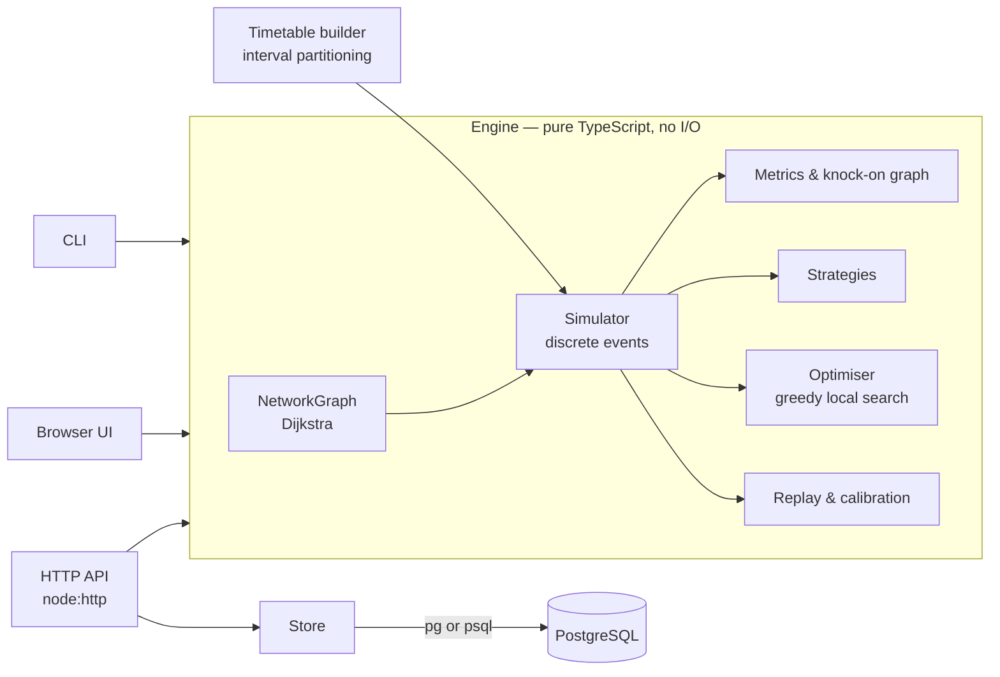

# RailTwin

A railway disruption simulator. It models trains moving over a network of stations, platforms and track sections, predicts how one delay spreads to other trains and connections, compares the responses a control room could take, searches for a better one, and measures its own predictions against what actually happened.

TypeScript (Node 22) · PostgreSQL 16 · no runtime dependencies besides `pg` · runs in the browser too.

```
npm install
npm test                       # 29 tests (Postgres tests run when DATABASE_URL is set)
npm run cli -- compare signal-failure
npm start                      # API + UI on http://localhost:3000
docker compose up              # same, with Postgres, seeded
```

## What it does

| Capability | Where |
|---|---|
| Trains, stations, timetables, platform capacity, single/double track, headways | `src/sim/simulator.ts` |
| Delay propagation with cause tracking (who waited for whom, and why) | `Simulator.closeWait`, `SimResult.knockOn` |
| Responses: hold connections, change platforms, prioritise trains, reroute | `Policy`, `Intervention` in `src/model/types.ts` |
| Comparison of responses against an undisrupted baseline | `src/sim/strategies.ts` |
| Search for the best combination of actions | `src/sim/optimiser.ts` |
| Replay of observed days, scored against two naive baselines; calibration with a held-out split | `src/sim/replay.ts` |
| Network map, train graph (time–distance diagram), comparison tables | `web/` |
| Persistence of networks, scenarios, observed days and runs | `sql/`, `src/db/` |

## How the simulation works

It is a **discrete-event simulation**. Nothing happens between events; the clock jumps from one to the next through a binary min-heap keyed on `(time, sequence)`, which also makes runs fully deterministic.

**Resources.** Each platform holds one train. Each track section holds an ordered queue of trains per direction, separated by its headway on entry and exit, so trains cannot overtake inside a section. A single-track section also excludes opposing movements.

**Blocking.** A train keeps the resource it is on until the next one is granted. A train that cannot get a platform waits on the approach section, which blocks the train behind it, which blocks the platform it is leaving. Knock-on delay therefore propagates backwards the same way it does on a real railway, without being scripted.

**Waiting and waking.** A blocked train parks on a key (`platform:RVC:2`, `section:ASH-COR`, `arrival-of:IC-D-0700`) and/or a timer. When a resource is released, only the trains parked on that key are woken, in the order the dispatch rule chooses (first come first served, priority, or timetable order). Each wait records its reason and the train that caused it, which is what the knock-on graph is built from.

**Gridlock.** Single lines can lock solid: two trains fill a passing loop, and a third is already on the single line heading for it. RailTwin applies the interlocking rule real signalling uses (*don't let a train onto a single line unless it has somewhere to go at the far end*) through berth reservations. Anything that still deadlocks is detected and the wait-for cycle reported. Building the rule was prompted by the simulator finding exactly this gridlock in the branch-line scenario.

**Connection holds** use a forecast: an outbound train only waits while the feeder's projected arrival (scheduled time plus its current delay) still makes the connection within the hold limit. Naive holding, which waits the full limit for feeders that can't make it, was measurably worse.

**Routing** uses Dijkstra over running times; a reroute intervention re-plans only the legs that touch the avoided section.

**Platforms** in generated timetables are assigned by interval partitioning: occupations sorted by start time, each taking the lowest-numbered platform free by then.

## The sample network

Shannon Vale is fictional: a double-track main line, two single-track branches with passing loops, a slower single-track cut-off usable as a diversion, two interchanges, and intercity, stopping, branch, coast and freight traffic: 47 trains and 25 planned connections between 06:00 and 10:00. The undisrupted timetable runs at 100% punctuality with no conflicts (this is a test).

Five scenarios:

| Scenario | Best preset | Passenger-minutes lost: no action → optimiser |
|---|---|---|
| Intercity 12 min late | Hold connections | 8,490 → 4,735 |
| Signal failure, Millbrook–Riverside (+8 min) | Integrated control | 22,560 → 9,089 (finds the reroutes over the cut-off) |
| Tree on the Lough Arden branch | No action | 5,260 → 5,260 |
| Four of five platforms closed at Riverside | Flexible platforms | 297,291 → 544 |
| Morning meltdown (four incidents) | Integrated control | 163,950 → 11,120 |

Results worth discussing:

* **More flexibility isn't always better.** In the branch blockage, allowing platform changes lets two trains crowd into the Corran loop and makes things worse (5,260 → 6,565 passenger-minutes). The optimiser declines it.
* **Holding is a trade.** In the late-intercity case, holding the 07:38 coast train for 6 minutes makes it 5 minutes late and delays the opposing coast service it crosses on the single line (+1 knock-on train), but saves 70 passengers a 60-minute wait for the next one. Net: 44% fewer passenger-minutes lost.
* **Priority dispatch rarely matters on this network.** The main line is short and has few places where a fast train catches a slow one. It helps a little in the meltdown scenario only.

Passenger-minutes = Σ(train passengers × arrival delay) + Σ(missed-connection passengers × wait for the next service). Every score in this README comes from `npm run cli -- compare|optimise|replay|calibrate`.

## Is the model any good? Replay

Each scenario has an "observed" day. The model gets only the incidents **as reported** and predicts every arrival; those predictions are scored against what happened, next to two baselines: *timetable* (everything on time) and *persistence* (a late train stays exactly as late, nothing else is affected).

Mean absolute error, minutes, at stops where the train was actually running at least 3 minutes late:

| Scenario | n | RailTwin | Timetable | Persistence |
|---|---:|---:|---:|---:|
| Late intercity | 4 | 2.00 | 11.63 | **1.13** |
| Signal failure | 39 | **3.00** | 6.79 | 6.79 |
| Branch blockage | 9 | **7.00** | 18.94 | 18.94 |
| Platform closure | 3 | **2.03** | 5.33 | 5.33 |
| Morning meltdown | 34 | **2.53** | 5.99 | 4.16 |

Over all 187 timed stops per day RailTwin's MAE is 0.35–0.93 min against 0.74–1.97 for the timetable, and 84–98% of predictions fall within 2 minutes.

Where it misses, the reason is visible. The tree was reported cleared at 07:50 but the line actually reopened at 07:56, so every branch prediction is about 6 minutes optimistic. Persistence wins the late-intercity case because that train is the only one running late and padding barely matters over 4 points. The model's bias is negative throughout (slightly optimistic), because real trains overrun a little everywhere.

**Calibration.** A grid search over a global running-time scale and extra dwell, fitted on three days and tested on the other two:

| Held-out day | MAE before → after | Bias before → after |
|---|---|---|
| Platform closure | 0.35 → 0.33 | −0.35 → +0.01 |
| Morning meltdown | 0.91 → 0.47 | −0.69 → −0.24 |

**About the data.** No real operational data ships with the repo, so the observed days are synthetic (`npm run gen:observed`): the simulator is run with the incidents as they really unfolded (longer than reported), the control room's actual policy, and seeded random running and dwell overruns, rounded to the half-minute. That tests robustness to imperfect information, not realism. To score against real data, import it (below).

## Performance

`npm run bench` on one core of a 2.1 GHz Xeon, Node 22:

| Network | Trains | Events | Time | Events / s |
|---|---:|---:|---:|---:|
| 6×6 grid | 250 | 2,423 | 14 ms | 170k |
| 10×10 grid | 1,000 | 13,915 | 26 ms | 535k |
| 14×14 grid | 4,000 | 89,240 | 265 ms | 337k |
| 20×20 grid | 8,000 | 245,390 | 1.3 s | 192k |

A full simulation of the sample network takes about 1 ms, so the optimiser can afford 150 complete simulations in under 200 ms, and the UI reruns live as you change settings.

The 8,000-train grid gridlocks: random routes over a lattice with single-track sections create resource cycles the single-line berth rule does not cover (cycles of full double-track stations). The engine detects and reports it rather than hanging. Throughput falls with congestion because more trains are queued per released resource. Per-platform wake keys were added after profiling showed every platform release waking every train queued for the station.

## Architecture



The engine has no I/O, so the same code runs in the API, the CLI, the tests and the browser (the UI bundles it and simulates client-side).

Database notes: bulk writes ship rows as one JSON document and expand them server-side with `jsonb_to_recordset`, so saving a scenario of any size is a handful of statements, and saving a run with all its stop times is a single statement using data-modifying CTEs. The client uses `pg` when installed and falls back to driving the `psql` CLI otherwise.

## API

| Method | Path | Body / query |
|---|---|---|
| GET | `/api/scenarios` | |
| GET | `/api/scenarios/:id` | |
| GET | `/api/policies` | preset responses |
| POST | `/api/scenarios/:id/simulate` | `{ policy?, label?, save?, full? }` |
| POST | `/api/scenarios/:id/compare` | `{ policies?: (presetId \| {name, policy})[] }` |
| POST | `/api/scenarios/:id/optimise` | `{ start?, maxEvaluations? }` |
| GET | `/api/scenarios/:id/replay` | `?policy=control&points=1` |
| GET | `/api/runs` | `?scenario=` |

Policies are validated strictly; unknown keys are rejected so a typo isn't silently ignored.

```json
{ "policy": { "holdConnections": true, "dispatch": "priority",
  "interventions": [{ "kind": "reroute", "train": "IC-D-0700", "avoid": ["MIL-RVC"] }] } }
```

Without `DATABASE_URL` the API serves the built-in scenarios from memory.

## Importing real observed times

```
DATABASE_URL=… npm run cli -- import-observed signal-failure observed.csv
```

```
train_id,seq,arr,dep
IC-D-0700,0,,07:12
IC-D-0700,1,07:21:30,07:23
```

`seq` is the stop's index in the train's calling pattern; times as `HH:MM[:SS]` or minutes after midnight.

## Limitations

* Rolling stock and crew are not modelled: each train run is independent, so a late arrival doesn't delay that unit's next working.
* Sections are single blocks with a headway, not individual signals.
* Junction conflicts (conflicting routes across a junction) are not modelled, only section occupancy.
* Passenger numbers are fixed per train, not loaded from demand data.
* Observed data is synthetic (see above).
* The optimiser is greedy. It finds good combinations quickly but can miss ones where two actions only help together.

## Project layout

```
src/model/       domain types
src/graph/       network graph, Dijkstra
src/sim/         simulator, metrics, strategies, optimiser, replay
src/timetable/   pattern expansion, platform assignment, connection finding
src/data/        Shannon Vale network, scenarios, observed days
src/db/          SQL client (pg / psql), repository
src/api/         HTTP server, store, validation
web/             UI (template + TypeScript), built by scripts/build-web.ts
sql/             migrations
test/            node:test suites
bench/           benchmark + latest results
```
